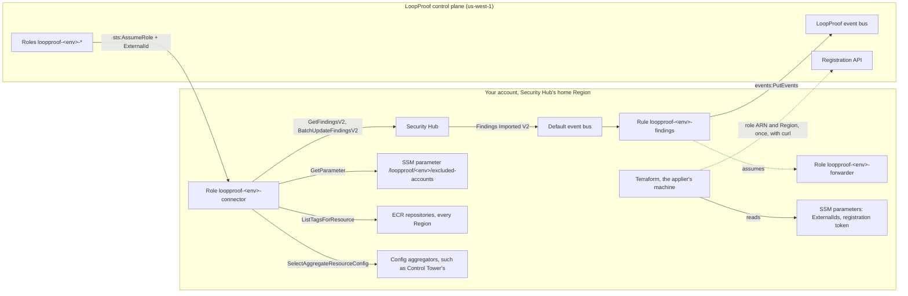

# Architecture



## The connector role

`loopproof-<environment>-connector` trusts the control-plane account (`arn:aws:iam::<account>:root`) under two
conditions:

* `ArnLike aws:PrincipalArn` `arn:aws:iam::<account>:role/loopproof-<environment>-*`: only LoopProof's own roles
  for that environment;
* `StringEquals sts:ExternalId` over the ExternalIds in the parameter that `external_ids_parameter_arn` names: one
  value, or two during a rotation.

Its inline policy `security-hub-findings`:

| Statement | Effect | Action | Why |
|-----------|--------|--------|-----|
| `ReadFindings` | Allow | `securityhub:GetFindings` | Authorizes `GetFindingsV2` |
| `UpdateFindings` | Allow | `securityhub:BatchUpdateFindings` | Authorizes `BatchUpdateFindingsV2` |
| `DenySeverityUpdates` | Deny | same | If the request sets `SeverityId` |
| `DenyUpdatesWithoutStatusOrComment` | Deny | same | If it sets no `StatusId` and no `Comment` |

Its inline policy `excluded-accounts-parameter` allows `ssm:GetParameter` on the
[excluded accounts' parameter](#excluded-accounts) alone, and its policies `ecr-repository-tags` and
`config-aggregator-query` read [resource tags](#resource-tags); the second can read more than tags. The role's
description names all of them.

The Security Hub v2 APIs have no IAM actions of their own: `GetFindingsV2` uses `securityhub:GetFindings`, and
`BatchUpdateFindingsV2` uses `securityhub:BatchUpdateFindings`
([Service Authorization Reference](https://docs.aws.amazon.com/service-authorization/latest/reference/list_securityhub.html),
[GetFindingsV2](https://docs.aws.amazon.com/securityhub/1.0/APIReference/API_GetFindingsV2.html),
[BatchUpdateFindingsV2](https://docs.aws.amazon.com/securityhub/1.0/APIReference/API_BatchUpdateFindingsV2.html)).
Those actions also authorize the older ASFF APIs. The `securityhub:OCSFSyntaxPath/<field>` condition key lets the
policy refuse a severity change, and refuse any update that carries no OCSF status or comment, which includes every
ASFF `BatchUpdateFindings` call.

## Resource tags

Where a finding's resource carries no tags, LoopProof derives them from a related resource: an ECR image's from its
repository. Neither Inspector's finding nor Security Hub's carries the repository's tags, so LoopProof reads them with
the connector role, one of two ways.

**The direct read**, policy `ecr-repository-tags`, always there:

| Statement | Effect | Action | Resource |
|-----------|--------|--------|----------|
| `ReadRepositoryTags` | Allow | `ecr:ListTagsForResource` | `arn:aws:ecr:*:<account>:repository/*` |

Every repository of the account, in every Region: Security Hub's home Region collects the findings of the linked
Regions, and a repository is in its finding's Region. The action has no dependent actions, and a repository's tags
aren't encrypted with its key, so it needs no KMS permission
([Service Authorization Reference](https://docs.aws.amazon.com/service-authorization/latest/reference/list_amazonelasticcontainerregistry.html)).
The Resource Groups Tagging API's `tag:GetResources` would read the tags too, but it takes no resource ARN in IAM and
returns every tagged resource of the account, of every type.

**The aggregator query**, policy `config-aggregator-query`, always there:

| Statement | Effect | Action | Resource |
|-----------|--------|--------|----------|
| `QueryConfigAggregators` | Allow | `config:SelectAggregateResourceConfig` | `config-aggregator/*`, see below |

AWS Control Tower keeps an AWS Config aggregator, `aws-controltower-GuardrailsComplianceAggregator`, in the Audit
account and its home Region, over the enrolled accounts, so the account where Security Hub collects findings can
read the organization's resources' tags from it. IAM names an aggregator by an ARN that ends in an ID AWS Config
generates, such as `arn:aws:config:us-west-1:<account>:config-aggregator/config-aggregator-a1b2c3d4`, not by its
name, so the grant covers every aggregator of the account in the module's Region,
`arn:aws:config:<module's Region>:<account>:config-aggregator/*`. It needs no input and no lookup;
where there's no aggregator it matches nothing, and it holds when Control Tower recreates its aggregator under a new
ID. It also reaches any other aggregator there, such as one the tenant made. LoopProof needs nothing to find Control
Tower's: `SelectAggregateResourceConfig` takes the aggregator's name
([Service Authorization Reference](https://docs.aws.amazon.com/service-authorization/latest/reference/list_awsconfig.html),
[SelectAggregateResourceConfig](https://docs.aws.amazon.com/config/latest/APIReference/API_SelectAggregateResourceConfig.html)).

The grant is in the module's Region only, Security Hub's home Region. Control Tower keeps its aggregator in Control
Tower's home Region; where the two differ, the role can't reach it.

Where neither read reaches the related resource, LoopProof marks the tags as not derived; it never holds a ticket
back for them.

## Forwarding

The rule `loopproof-<environment>-findings`, on the default bus, forwards a finding if its severity is one of
`severities`, or if it is GuardDuty's, at any severity. With the default `severities`, it matches:

```json
{
  "source": ["aws.securityhub"],
  "detail-type": ["Findings Imported V2"],
  "detail": {
    "findings": {
      "$or": [
        {"severity_id": [4, 5, 6]},
        {"metadata": {"product": {"name": ["GuardDuty"]}}}
      ]
    }
  }
}
```

Security Hub sends one finding per event, at `detail.findings[0]`, in OCSF
([event format](https://docs.aws.amazon.com/securityhub/latest/userguide/securityhub-v2-cwe-event-formats.html)).
`$or` matches if either of its patterns does
([EventBridge](https://docs.aws.amazon.com/eventbridge/latest/userguide/eb-create-pattern-operators.html)).

GuardDuty's findings are forwarded at every severity, whatever `severities` lists, by the finding's
`metadata.product.name`, as Security Hub writes it. GuardDuty sends few findings next to Inspector and CSPM, and a
threat below High is still a threat: every part of an attack sequence reaches LoopProof, and a finding whose severity
drops arrives as an event. Inspector's, CSPM's and exposure findings are forwarded only at a severity `severities`
lists. LoopProof decides what it acts on, so GuardDuty's every severity isn't an input. Through 1.1.0, the rule
forwarded GuardDuty's findings by `severities` too.

The rule matches the OCSF `severity_id`, which OCSF requires, rather than the `severity` caption, which for
`Other` (99) the source defines ([OCSF](https://schema.ocsf.io/1.6.0/classes/detection_finding)). The `severities`
input takes the captions and the module maps them:

| `severities` value | `severity_id` |
|--------------------|---------------|
| Unknown | 0 |
| Informational | 1 |
| Low | 2 |
| Medium | 3 |
| High | 4 |
| Critical | 5 |
| Fatal | 6 |
| Other | 99 |

When `excluded_accounts` lists accounts, the pattern also refuses their findings, by the finding's account. The
account filter sits beside the `$or`, so it applies to both: an excluded account's GuardDuty findings stay in your
account too.

```json
{
  "source": ["aws.securityhub"],
  "detail-type": ["Findings Imported V2"],
  "detail": {
    "findings": {
      "$or": [
        {"severity_id": [4, 5, 6]},
        {"metadata": {"product": {"name": ["GuardDuty"]}}}
      ],
      "cloud": {"account": {"uid": [{"anything-but": ["111122223333"]}]}}
    }
  }
}
```

With an empty list, the pattern has no account filter, as before the input existed: `anything-but` with no values
isn't a valid pattern. A finding without `cloud.account.uid` doesn't match `anything-but`, so while accounts are
excluded it isn't forwarded, GuardDuty's neither; Security Hub's findings carry it. The filter relies on one finding
per event: EventBridge matches an array when any of its elements matches, so an event that held findings of an
excluded account and of another would be forwarded whole.

The rule doesn't filter on the activity: new (`Create`), updated and closed findings all pass, and the control plane
drops the echoes of its own updates. Security Hub CSPM events share the `aws.securityhub` source but use another
detail-type, so they don't match.

The target is LoopProof's bus, in another account and usually another Region. EventBridge requires a role for such a
target; `loopproof-<environment>-forwarder` trusts `events.amazonaws.com` for this rule only (`aws:SourceArn`,
`aws:SourceAccount`) and may only `events:PutEvents` on that bus.

## Excluded accounts

The `String` parameter `/loopproof/<environment>/excluded-accounts`, in the module's Region, holds `excluded_accounts`
sorted, as JSON: `[]` when you exclude nothing. It always exists, so that LoopProof can tell a connector that excludes
nothing from one too old to say. LoopProof reads it with the connector role when it proves your account and daily
after: the registration token works only until then, and the list may change later. It's a standard parameter, not a
`SecureString`, so it isn't encrypted with a KMS key and reading it needs no KMS permission
([Parameter Store and KMS](https://docs.aws.amazon.com/kms/latest/developerguide/services-parameter-store.html)).

## The parameters

The tenant's root creates two SSM SecureString parameters (Part 1), with the write-only placeholder `unset`, and
passes their ARNs to the module (Part 2). The module reads them with the AWS provider's credentials:

* the ExternalIds with `data "aws_ssm_parameter"`, decrypted. Two postconditions check the value before anything
  uses it: first that it isn't the placeholder, then that it is a JSON list of one or two ExternalIds. Only then
  does `local.external_ids` decode it, for the trust policy;
* the token with `ephemeral "aws_ssm_parameter"`, decrypted, which Terraform keeps out of the plan and the state.

On a new root's first apply, the parameters' ARNs are unknown at plan, so both reads wait until the apply has created
the parameters; the ExternalIds' check then stops the run at the placeholder. After the tenant fills both, the next
apply creates the connector.

## Registration

`terraform_data.registration`, keyed on the role's ARN (`triggers_replace`), runs a `local-exec` provisioner when it
is created: `/bin/sh files/register.sh`, after the role and its policies exist. The script:

1. checks `command -v curl` and `curl --version`, and fails with a plain message without curl 7.76.0 or later;
2. fails, naming the parameter, if the token parameter holds the placeholder or something that doesn't start with
   `lprt_`;
3. POSTs `{"role_arn": "<role arn>", "region": "<region>"}` to `registration_url` with
   `curl -sS --fail-with-body --max-time 30`, the header `Authorization: Bearer <token>` read from standard input;
4. succeeds on a 2xx; fails at once on a 4xx; tries again after a connection error, a timeout or a 5xx, four
   attempts in all.

A failure prints LoopProof's answer and what to do, and leaves the resource tainted, so the next apply runs it
again. A replaced role has an unknown ARN in the plan, which replaces the resource and registers again; so does
`terraform apply -replace`. Nothing else does: later plans and applies make no call. See
[Security](security.md#the-registration-token) for what Terraform prints and stores.

What to do depends on whether LoopProof has proven the account, which the script can't see, so it says both:

* a new registration token, where one helps, comes from LoopProof's onboarding before, and after, from LoopProof's
  Settings page, where an admin of the tenant mints one that registers only the role the tenant already has;
* the role's ARN and the Region, which it prints, can be pasted into LoopProof's onboarding instead only before.
  After, LoopProof takes no paste, and the registration needs a token and a machine that reaches LoopProof.

`region` is the AWS provider's Region, such as `us-east-1`: the Region the module is applied in, which should be
Security Hub's home Region. LoopProof reads the findings there. An IAM role ARN carries no Region, so LoopProof can't
learn it otherwise.
